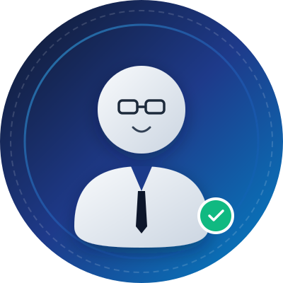

# 📄 Website Curriculum Vitae (CV) & Portofolio Personal

Website Curriculum Vitae (CV) modern, profesional, elegan, dan fully responsive yang dibuat dengan **HTML5, CSS3 murni, dan JavaScript modern**.

---

## 🌟 Fitur Utama & Keunggulan

1. **Desain Modern & Elegan:**
   - Palet warna profesional: Kombinasi **Navy (#0F172A & #1E3A8A), Putih, dan Abu-abu lembut (#F8FAFC & #E2E8F0)**.
   - Tipografi modern menggunakan kombinasi font **Poppins** (headings/judul) dan **Inter** (teks paragraf).
   - Layout rapi, proporsional, dengan spacing yang lega dan nyaman di mata (*readability* tinggi).

2. **Struktur Halaman Lengkap:**
   - **Navbar Sticky**: Dilengkapi efek *backdrop blur*, indikator link aktif otomatis (*Scrollspy*), dan hamburger menu interaktif untuk mobile.
   - **Hero Section**: Menampilkan foto profil berbingkai elegan, status ketersediaan kerja dengan animasi denyut (*pulsing badge*), efek mengetik otomatis (*dynamic typing effect*), deskripsi singkat, tombol aksi, dan tautan sosial media.
   - **About Me**: Narasi karakter profesional, visi karier, kartu ringkasan kualifikasi, serta *trait pills*.
   - **Education**: Timeline vertikal interaktif dengan penanda ikon, badge tahun, informasi universitas/institusi, IPK/predikat, dan mata kuliah relevan.
   - **Skills**: Pemisahan jelas antara **Hard Skills** (dilengkapi animasi *progress bar* persentase yang berjalan saat di-scroll) dan **Soft Skills** (kartu interaktif dengan ikon dan deskripsi).
   - **Experience & Projects**: Dilengkapi tombol **filter kategori interaktif** (*Semua*, *Kerja & Magang*, *Organisasi & Panitia*, *Proyek Portofolio*).
   - **Contact**: Menampilkan panel kontak langsung (Email dengan tombol *1-Click Copy*, WhatsApp, Lokasi, status kerja) serta formulir kontak interaktif dengan validasi form dan notifikasi *toast*.

3. **Fitur Ekstra & Interaktivitas:**
   - **Unduh CV Multi-Opsi**: Tombol download CV membuka jendela modal elegan dengan 2 opsi:
     - *Cetak / Simpan ke PDF*: Otomatis memicu fungsi cetak browser yang telah dioptimalkan dengan CSS `@media print` sehingga langsung menghasilkan lembar resume siap pakai.
     - *Unduh File PDF Siap Pakai*: Mengunduh berkas file PDF statis yang tersimpan di folder `assets/`.
   - **Salin Email Instan**: Fitur salin email ke clipboard hanya dengan satu klik disertai konfirmasi toast notifikasi.
   - **Scroll Reveal & Animations**: Animasi halus saat scroll menggunakan *Intersection Observer*.
   - **Tombol Kembali ke Atas (Back to Top)**: Tombol melayang (*floating*) yang muncul otomatis saat scroll melewati 350px.
   - **100% Responsif**: Dioptimalkan sempurna untuk layar Desktop, Laptop, Tablet, hingga Smartphone layar kecil.

---

## 📁 Struktur Berkas

```text
test/
├── index.html                 # Struktur utama HTML & konten teks CV
├── style.css                  # Gaya desain, tema Navy, animasi, & layout responsif
├── script.js                  # Logika interaktif, typing effect, filter, modal, form
├── README.md                  # Panduan penggunaan & kustomisasi
└── assets/
    ├── profile-placeholder.svg # Foto profil vektor placeholder modern
    └── sample-cv.pdf          # Berkas contoh CV format PDF
```

---

## 🚀 Cara Menjalankan Website

Tidak memerlukan instalasi server atau dependensi rumit:
1. Cukup klik ganda (*double click*) file **`index.html`** untuk langsung membukanya di browser favorit Anda (Google Chrome, Microsoft Edge, Mozilla Firefox, Safari).
2. Atau jika menggunakan ekstensi VS Code seperti **Live Server**, klik kanan pada `index.html` lalu pilih **"Open with Live Server"**.

---

## ✏️ Panduan Mengganti Data Pribadi Anda

Seluruh teks di dalam file **`index.html`** telah diberi tanda komentar `<!-- EDIT: ... -->` agar sangat mudah ditemukan dan disesuaikan.

### 1. Mengganti Foto Profil
- Simpan file foto Anda (misalnya berformat `.jpg` atau `.png`) ke dalam folder `assets/`, misalnya `assets/foto-saya.jpg`.
- Buka file `index.html`, cari baris berikut:
  ```html
  
  ```
- Ubah `src="assets/profile-placeholder.svg"` menjadi `src="assets/foto-saya.jpg"`.

### 2. Mengubah Nama, Gelar, dan Profesi
- Di `index.html`, cari bagian `<h1 class="hero-title">` dan ubah nama placeholder:
  ```html
  <span class="text-highlight">Alex Pratama, S.Kom</span>
  ```
- Untuk mengubah teks animasi pergantian profesi, buka file **`script.js`**, cari variabel `roles`:
  ```javascript
  const roles = [
    'Frontend Web Developer',
    'UI/UX Enthusiast',
    'Teknik Informatika Graduate'
  ];
  ```
  Anda dapat menambahkan atau mengganti profesi sesuai keahlian Anda.

### 3. Mengganti File CV PDF
- Letakkan file CV PDF asli Anda di dalam folder `assets/` dengan nama `sample-cv.pdf` (atau sesuaikan link di `index.html` pada tag `<a href="assets/sample-cv.pdf">`).

### 4. Mengubah Kontak & Media Sosial
- Buka `index.html`, masuk ke bagian `<section id="contact">`:
  - Ubah alamat email pada `alex.pratama@example.com` dan atribut `href="mailto:..."`.
  - Ubah nomor WhatsApp pada `https://wa.me/6281234567890`.
  - Ubah URL tautan LinkedIn, GitHub, Instagram, dan Twitter pada tag `<a>` yang tersedia.

### 5. Mengubah Riwayat Pendidikan, Pengalaman, dan Skill
- Seluruh bagian Pendidikan (`#education`), Keahlian (`#skills`), dan Pengalaman (`#experience`) menggunakan elemen HTML semantik yang terstruktur rapi. Anda cukup menyalin blok `<div class="timeline-item">` atau `<div class="experience-card">` jika ingin menambah riwayat baru.

---

## 🖨️ Fitur Cetak / Export PDF Khusus

Website ini telah dilengkapi stylesheet cetak `@media print` tingkat lanjut di `style.css`. Ketika Anda atau perekrut (recruiter) menekan tombol **"Cetak / Simpan ke PDF"** (atau `Ctrl + P` di browser):
- Navigasi, formulir pesan, tombol interaktif, dan elemen dekoratif otomatis disembunyikan.
- Layout berubah menjadi format resume resmi standar internasional yang bersih, siap disimpan sebagai PDF atau dicetak di atas kertas A4.

